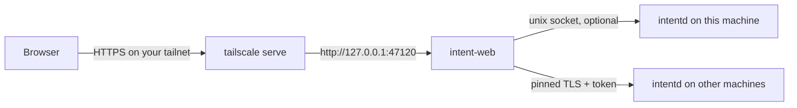

# Run Intent Web on a cloud machine

> **Experimental.** `@intent-hq/web` is unreleased until its first npm publish
> (see [Publishing @intent-hq/web](./intent-web-package.md)). Commands and
> options may still change.

`@intent-hq/web` (command `intent-web`) is a small Node server that serves the
Intent web app without the desktop app. Run it on a VPS or dev box, put an
HTTPS front-end such as `tailscale serve` in front of it, sign in from any
browser with an access key, and work against the Intent machines (`intentd`)
you already run there or elsewhere.



`intent-web` does not install, start or update `intentd`, and it does not
terminate TLS. It listens only on loopback (or a unix socket).

## Requirements

- Node.js `^22.22.2 || ^24.15.0 || >=26` (`node --version`).
- An HTTPS front-end. This guide uses [Tailscale](https://tailscale.com)
  (`tailscale serve`); Caddy or nginx with a real certificate work the same
  way.
- At least one `intentd` to work against: on this machine, on another machine,
  or both.
- Optional: [tailcat](#tunnel-routes-tailcat) for tunnel routes.

## Quick start with `tailscale serve`

1. Start the server:

   ```sh
   npx @intent-hq/web
   ```

   The first run prints the listen address (`http://127.0.0.1:47120`), the
   data directory and the **access key**. Copy the key now; later runs print
   "Access key unchanged; run intent-web key to show it."

2. In a second shell, publish the port on your tailnet over HTTPS:

   ```sh
   tailscale serve --bg 47120
   ```

   If it answers "Access denied: serve config denied", run it with `sudo`, or
   allow your user once with `sudo tailscale set --operator=$USER`.
   `tailscale serve status` shows the address, for example
   `https://<machine>.<tailnet>.ts.net`. Only devices on your tailnet can reach
   it. Use `tailscale serve --https=8443 --bg 47120` to keep port 443 free for
   something else, and `tailscale serve reset` (or `--https=<port> off`) to
   remove it. Do **not** use `tailscale funnel`: it publishes the server to the
   whole internet.

3. Open the `https://` address in a browser, enter the access key and choose
   **Sign in**.

4. Add your machines in **Settings → Machines** (see
   [Adding machines](#adding-machines)). If this machine runs `intentd`, it is
   already listed as **This machine (local)**.

To keep the server running after you log out, run it under your process
supervisor. A systemd user unit, for example:

```ini
# ~/.config/systemd/user/intent-web.service
[Unit]
Description=Intent Web

[Service]
ExecStart=/usr/bin/env npx --yes @intent-hq/web serve
Restart=on-failure

[Install]
WantedBy=default.target
```

```sh
systemctl --user daemon-reload
systemctl --user enable --now intent-web
loginctl enable-linger "$USER"   # keep user services running without a login session
```

Pin a version (`@intent-hq/web@<version>`) if you do not want `npx` to pick up
new releases on restart.

## The access key

The access key is a random 256-bit secret. Entering it once sets an
HttpOnly session cookie (Secure behind HTTPS) that lasts 30 days.

| Task            | Command                          |
| --------------- | -------------------------------- |
| Show the key    | `npx @intent-hq/web key`         |
| Replace the key | `npx @intent-hq/web key --reset` |

`key --reset` prints the new key and signs out every browser at once: the
running server notices the change, rejects old session cookies and closes
their live connections. Saved machines are kept. Use it whenever the key may
have leaked, and after removing someone's access.

Pass the same `--data-dir` to `key` that the server uses, or the command reads
a different key. Too many wrong keys in a short time lock sign-in for everyone
for a while.

## The data directory

| Platform      | Default                                                        |
| ------------- | -------------------------------------------------------------- |
| Linux / macOS | `$XDG_STATE_HOME/intent-web`, else `~/.local/state/intent-web` |
| Windows       | `%LOCALAPPDATA%\intent-web`                                    |

Change it with `--data-dir <dir>` or `INTENT_WEB_DATA_DIR`. The directory is
created with mode `0700` and holds:

| File                        | Contents                                                                                                                                          |
| --------------------------- | ------------------------------------------------------------------------------------------------------------------------------------------------- |
| `config.json` (`0600`)      | The access key and the port. `--port` / `INTENT_WEB_PORT` is saved here, so later runs reuse it.                                                  |
| `connections.json` (`0600`) | Saved machines: host, port, pinned certificate fingerprint, tunnel address and the machine **token in plain text** (marked `"encrypted": false`). |

Treat the directory like an SSH key: anyone who can read it can use every
saved machine. Back it up only to places you would put a private key. Deleting
it resets everything (a new key on the next start, no saved machines).

## Commands and options

| Command / flag                    | Purpose                                                            |
| --------------------------------- | ------------------------------------------------------------------ |
| `intent-web` / `intent-web serve` | Start the server                                                   |
| `--port <n>`                      | Loopback TCP port (default 47120)                                  |
| `--socket <path>`                 | Listen on a `0600` unix socket instead of TCP (for Caddy or nginx) |
| `--data-dir <dir>`                | Data directory (see above)                                         |
| `--tailcat <path>`                | tailcat binary for tunnel routes                                   |
| `--local-socket <path>`           | Use this local `intentd` socket                                    |
| `--no-local`                      | Ignore any local `intentd`                                         |
| `intent-web key [--reset]`        | Show or replace the access key                                     |
| `intent-web --help`               | Print usage                                                        |

Environment variables `INTENT_WEB_PORT`, `INTENT_WEB_DATA_DIR` and
`TAILCAT_BIN` work like the flags; flags win. There is no option to listen on
`0.0.0.0`.

## Local daemon mode

If this machine runs `intentd`, `intent-web` connects to its unix socket and
shows it as **This machine (local)**, the default machine for new tabs. It
looks for the standard socket at start-up:

| Platform | Socket                                                                            |
| -------- | --------------------------------------------------------------------------------- |
| Linux    | `$XDG_DATA_HOME/intentd/intentd.sock`, else `~/.local/share/intentd/intentd.sock` |
| macOS    | `~/Library/Application Support/intentd/intentd.sock`                              |
| any      | `$INTENTD_DATA_DIR/intentd.sock` when `INTENTD_DATA_DIR` is set                   |

- Start `intentd` first; the socket is only checked when `intent-web` starts.
  Restart `intent-web` after you install or move the daemon.
- `--local-socket <path>` uses a daemon with a non-standard data directory.
- `--no-local` hides the local daemon, for example when the browser should
  only reach remote machines.

The local machine needs no token, port or certificate: whoever signs in with
the access key gets the same access as a local desktop app. It cannot be
forgotten from **Settings → Machines**.

## Adding machines

On each remote machine, enable external connections and print its pairing
details:

```sh
intentd pair
```

It prints the host, port, bearer token and TLS certificate fingerprint. (Pass
`--host <address>` to name the address `intent-web` should dial, for example
the machine's tailnet name.) Then, in the browser:

1. **Settings → Machines → Add machine**.
2. Enter the host, port and token.
3. **Capture fingerprint**, and check it matches the fingerprint `intentd
pair` printed.
4. **Test connection**, then save.

The machine appears in the Machines list and in the machine switcher. Opening
it opens a new tab bound to it, so you can keep several machines open side by
side. The token goes to the server once and is never sent back to a browser.

The `intent-web` server makes the connection, not the browser, so the host
must be reachable **from the cloud machine** (for example over the same
tailnet).

## Tunnel routes (tailcat)

A machine's tunnel address lets `intent-web` reach it through a Tailscale
`tailcat` tunnel when its direct host and port are unreachable. It needs the
[tailcat](https://github.com/tailscale/tailcat) client (BSD-3-Clause), version
0.4.0, from its GitHub releases.

`intent-web` looks for it in this order: `--tailcat <path>`, then
`TAILCAT_BIN`, then `tailcat` on `PATH`. At start-up it runs
`tailcat --version` and warns when the version differs from 0.4.0. Without
tailcat, it prints "Tunnel routes need tailcat: set TAILCAT_BIN or put tailcat
on PATH.", the tunnel field in **Settings → Machines** shows the same note, and
direct host and port routes keep working.

## Security notes

- **Never expose the port directly.** `intent-web` speaks plain HTTP on
  loopback. Put an HTTPS front-end in front of it and keep that front-end
  private (a tailnet, a VPN, or an authenticating proxy).
- **One key, one owner.** There are no accounts or per-user permissions.
  Anyone with the access key has full control of every saved machine,
  including running agents and commands on them.
- **Outgoing connections.** The key holder can make the server connect to any
  host and port it can reach, including services on the cloud machine's
  private network. Run it where that is acceptable.
- **Tokens at rest.** Machine tokens are stored in plain text in
  `connections.json` (`0600`, in a `0700` directory). Protect the data
  directory and its backups; rotate a machine's token from **Settings →
  Machines** if the directory leaks.
- **Browser protections.** Sign-in is rate-limited; the server rejects
  requests whose `Host` is neither loopback nor the front-end's forwarded host,
  WebSocket and mutating requests from other origins, and non-JSON mutating
  requests.
- **Resetting the key** signs out every browser and closes their live
  connections immediately (see [The access key](#the-access-key)).

## Troubleshooting

| Symptom                                        | Fix                                                                                                                                     |
| ---------------------------------------------- | --------------------------------------------------------------------------------------------------------------------------------------- |
| `Web build missing; run pnpm build:web first.` | The package is incomplete; reinstall it (`npx --yes @intent-hq/web@latest`).                                                            |
| `EADDRINUSE` on start                          | Another process uses the port; pass `--port <n>` (it is saved for later runs).                                                          |
| Sign-in page keeps coming back                 | The key was reset; run `intent-web key` with the server's `--data-dir`.                                                                 |
| A machine shows a certificate mismatch         | The daemon's certificate changed. Confirm the new fingerprint with `intentd pair` on that machine before accepting it.                  |
| **This machine (local)** is missing            | `intentd` was not running when `intent-web` started, or it uses another data directory; restart `intent-web`, or pass `--local-socket`. |
